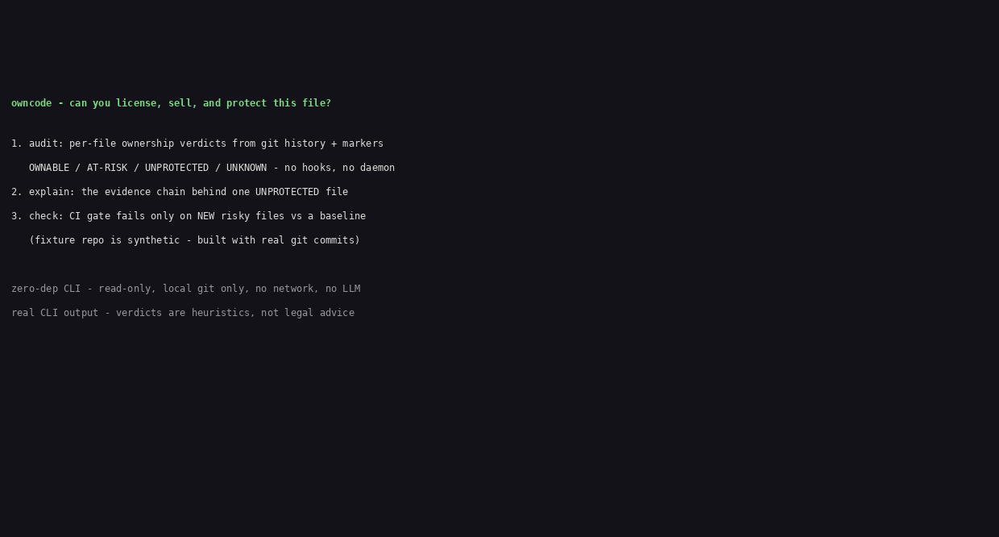

# owncode

**Audit a repository for AI-code ownership and licence provenance - and answer per file: can you license, sell, and protect this file?**

`owncode` reconstructs, from git history and markers already in the repo, which files are human-written, AI-assisted, or pure AI output - then maps each file to an ownership verdict under the US Copyright Office rule, plus licence-header and attribution coverage. No install-before-you-write, no daemon, no hooks, no git notes. It works on any repo exactly as it stands today. Zero runtime dependencies. TypeScript, Node 20+.

## Why this exists

On 15 November 2026 Jakub T. Jankiewicz (jcubic - jQuery Terminal, LIPS Scheme, isomorphic-git maintainer) published "All AI-generated code should be Open Source" (jakub.jankiewicz.org/blog/ai-code-open-source/). It reached 1,053 points and 573 comments on Hacker News (checked 16 November 2026). Two arguments: (1) models learn from scraped open source and Stack Overflow content under licences that require attribution, so closing the output as proprietary is "licence laundering"; (2) purely AI-generated code has no human author, so it gets no US copyright protection (US Copyright Office AI guidance Part 2, 29 January 2025; Thaler v. Perlmutter) - while the UK and some other countries DO protect machine-generated works. He calls on developers to release AI code under an open-source licence or CC0. The strongest rebuttal on Hacker News: if AI code has no copyright, putting an open-source licence on it is meaningless. US law does NOT require open source - this is a normative claim, not a legal rule. `owncode` does not take a side in that debate. It answers the prior question every team needs first: which of your files are AI output at all, and which of them can you actually license, sell, and protect?

The numbers behind the gap are fresh. **Black Duck 2026 OSSRA: 68% of the 947 commercial codebases audited contained licence conflicts - the largest single-year jump in the study's eleven-year history (up from 56%).** The primary driver: AI coding assistants generating snippets derived from copyleft-licensed repositories without retaining licence metadata. Black Duck calls it "licence laundering". Only **54% of surveyed organisations check AI-generated code for IP and licence risks, vs 76% who check it for security vulnerabilities.** In early 2026 an AI-assisted reimplementation of a GPL-licensed library (the chardet / charset-normalizer case) was used to create an MIT-licensed alternative - raising the question whether AI-mediated "clean room" reimplementation is independent work at all. Most AI coding tools leave no trace in version control. Claude Code defaults to `Co-Authored-By: Claude` trailers, but that is one point on a broader spectrum. Teams ship AI-written code with no record of who owns it - and no decision is made until a dispute arrives.

## 1. How it compares (checked 16 November 2026)

| Tool | Form | What it does well | What it cannot do (owncode's wedge) |
|---|---|---|---|
| **git-ai** (acunniffe/git-ai, usegitai.com) | CLI + daemon | True line-level attribution when installed from day one: agent hooks plus a background daemon reading git trace2 events; stores line ranges per agent session in git notes (`refs/notes/ai`); `git-ai blame`, `git-ai stats` | FORWARD-ONLY: a repo that never installed git-ai has zero provenance. Requires adoption before the code is written. No licence-decision layer: no OWNABLE / AT-RISK / UNPROTECTED verdict, no licence-header coverage, no third-party attribution check. owncode works on any repo as it stands today. |
| **ScanCode Toolkit** (AboutCode) | Python CLI | Detects licences, copyrights and package manifests; snippet-level matching against a licence database (can flag a 15-line function matching a GPL original even with renamed variables); local, JSON output | Detects licences present in code. Does not attribute AI vs human authorship, does not answer copyrightability, is a heavyweight scan, not a CI ownership gate. |
| **FOSSA CLI** | CLI + SaaS backend | Dependency-level + snippet-level licence analysis, policy enforcement in CI, GitHub check status per PR | SaaS backend, dependency-level focus; no AI-authorship reconstruction; commercial terms. |
| **Snyk Open Source** | CLI + CI plugins | Licence compliance module, policy-based blocking surfaced inline in pull requests (Team/Enterprise plans) | Paid tiers; scans dependencies and generated code for licences, does not reconstruct who wrote a file or whether it is copyrightable. |
| **REUSE** (FSFE) | CLI | Checks SPDX licence/copyright headers per file | Checks headers exist. Does not ask who wrote the file, whether it is AI output, or whether it can be protected. |
| **licensee** (GitHub) | CLI / Ruby gem | Detects the repository LICENSE | Repo-level only; no per-file answer. |
| **claimtrace** (own factory, #19) | CLI | Verifies agent claims against the session transcript | Different axis: report-vs-transcript. owncode is file-vs-history + licence. |
| **skill-lock** (own factory, #18) | CLI | Pre-run integrity pin/verify for agent skills | Different axis: skill integrity, not code ownership. |

**Where rivals beat us (read this before trusting owncode alone):** git-ai has true line-level attribution when installed from day one - owncode reconstructs file-level provenance from history, which is coarser and loses signal when history is squashed or rebased; ScanCode has deep snippet matching against licence databases - owncode does marker and heuristic detection with no snippet database; FOSSA/Snyk have commercial databases and remediation guidance. owncode v0.1.0 is a heuristic audit, not legal advice, and says so on every output.

## 2. Quickstart (install from source)

The `owncode` package is not published to npm yet (the name is unclaimed - npm returned 404 when checked on 16 November 2026). Install from source:

```sh
git clone https://github.com/techdevfun/owncode.git
cd owncode
npm install
npm run build
node dist/cli.js --help
```

Or link the binary locally:

```sh
npm link
owncode --help
```

## 3. Demo



The demo runs the real CLI on a synthetic fixture repo (built with real git commits by `scripts/capture-demo.sh`): one human file (OWNABLE), one Claude co-authored file (AT-RISK), one pure-AI file (UNPROTECTED), one vendored file without attribution (AT-RISK); then `explain` on the UNPROTECTED file; then the `check` CI gate failing on one new pure-AI file vs a saved baseline. GIF: 26.8 seconds, 535 frames. The full transcript is in `demo/transcript.txt`.

## 4. Commands

```sh
owncode audit [path] [--json] [--since <ref>] [--config <file>]
        [--save-baseline <file>] [--all]
owncode check --baseline <file> [--path <dir>] [--json]
owncode diff <baseline-a> <baseline-b>
owncode explain <file> [--path <dir>] [--json]
owncode init
owncode --help | --version
```

Exit codes: `0` = no AT-RISK / UNPROTECTED file; `1` = at least one risky file (audit/check); `2` = usage error or not a git repo.

- `audit` scans the repo at `path` (default `.`) and prints a per-file table plus a summary line with counts per verdict and attributable coverage. `--json` prints the same data with per-file evidence and commit SHAs. `--since <ref>` limits history to `<ref>..HEAD`. `--save-baseline` writes a baseline file for the `check` gate. At most 2,000 files are scanned by default (`--all` removes the cap); `owncode.config.json` can change it.
- `check` fails (exit 1) only on NEW risky files vs a saved baseline, so an existing project can adopt the gate without fixing history first. Files fixed since the baseline are listed, not failed.
- `diff` compares two baselines: new, fixed, and unchanged findings.
- `explain` drills into one file: every evidence item (trailer, marker, commit SHA, licence-header status) behind its verdict.
- `init` writes `owncode.config.json` with the default policy (AI marker patterns, licence allowlist, ignored paths, max files).

## 5. Verdict rules

| Verdict | Meaning |
|---|---|
| **OWNABLE** | Human-authored, or human-edited after AI generation, licence header present, no attribution gap. (Human authorship is the US Copyright Office test; the verdict is a heuristic, not a legal opinion.) |
| **AT-RISK** | AI-attributed with no human edit after, OR licence header missing, OR third-party code without attribution. Needs a human decision before licensing/selling. |
| **UNPROTECTED** | Pure AI output: 100% of commits touching the file are AI-attributed, no human author anywhere in the file's history, no licence header. Under US Copyright Office guidance this file is likely uncopyrightable in the US - the UK and some other jurisdictions protect machine-generated works. Labelled as guidance with the jurisdiction caveat on every output. |
| **UNKNOWN** | History too thin to judge (no commits in range, or a single commit with no signals and no licence header). Reported separately with a coverage percentage. Never silently counted as human. |

Provenance signals per file (all local, git only, no network, no LLM):

- **S1 Commit trailers** - `Co-Authored-By: <Claude / ChatGPT / Copilot / Codex / Gemini / agent>` or `Generated-By:` in commit messages. Human author + AI trailer = AI-assisted.
- **S2 In-file AI markers** - `Generated by`, `Generated with`, `AI-generated`, `Co-Authored-By` in header comments, `DO NOT EDIT - generated` style banners. The bare word "generated" in normal prose is NOT a marker.
- **S3 Agent paths** - files under `.ai/`, `agent/`, or with `.gen.` / `.ai.` infixes, unless a human commit later rewrote them.
- **S4 Human-edit ratio** - share of commits touching the file that are human-authored. A human commit after AI generation counts as a human edit. The tool CANNOT verify review depth - a human commit is evidence of a human touch, not of review.
- **S5 Licence header** - SPDX identifier or copyright line in the first 40 lines. Absent = finding.
- **S6 Attribution gap** - files under `vendor/`, `third_party/`, `external/` without a NOTICE / attribution / licence file nearby = finding.

## 6. Live check: a real repo (16 November 2026)

The fixture demo is synthetic, so during the build `owncode` was also run against a real public repo that carries `Co-Authored-By: Claude` commits: **multigres/multigres** ("Vitess for Postgres"). Sample commit `42a829a9043e6fffa238c1867558cdc331a053d6` (`chore(metriccatalog): regenerate catalog for metrics.go line shift`) carries `Co-Authored-By: Claude Sonnet 5.5 <noreply@anthropic.com>`, human author Mats Kindahl. Audit of a depth-30 clone (2,592 files, `--all`) finished in about 1.3 seconds:

- OWNABLE 1,786 | AT-RISK 94 | UNPROTECTED 0 | UNKNOWN 712 | attributable 73% (1,880/2,592 files) - exit 1.
- The 94 AT-RISK files are driven mostly by S2 markers (77 files carry one): classical code-generator banners, not AI output. Examples found in the live run: `docs/api/multiadmin.openapi.yaml` line 1 ("Code generated by make proto. DO NOT EDIT."), `go/common/parser/ast/ast_clone.go` (generator banner), and `docs/kubernetes/eks.md` ("Do not edit generated `Shard`..." - prose about generated resources). The `DO NOT EDIT - generated` rule cannot tell a protoc/stringer/mockgen banner from an AI banner, so classical generated code lands in AT-RISK. That is the safe direction for a gate (a human decides), but it is a real precision cost - see Honest limits. The other drivers overlap: 24 files lack a licence header, 8 sit on agent paths, 1 file carries a Claude agent signal.
- The single Claude-signal file is `CLAUDE.md` (AT-RISK): it documents the `Co-Authored-By: Claude` trailer convention, and the marker detector fires on that documentation line. Docs that describe the convention look like the convention.
- The 712 UNKNOWN files are inflated by the shallow clone: with only 30 commits of history, most files have a single in-range commit and no header. On a full clone the UNKNOWN share falls. The coverage percentage exists precisely to expose this.

## 7. CI flow

```yaml
- run: npm ci
- run: npm run build
- run: npm test
- run: node dist/cli.js audit . --save-baseline owncode-baseline.json
- run: node dist/cli.js check --baseline owncode-baseline.json
```

Keep the baseline file outside the repo or untracked: a baseline committed into the repo gets audited like any other file. The workflow in `.github/workflows/ci.yml` runs the unit + e2e suite and the live smoke test on Node 20.x and 22.x.

## 8. Honest limits

- **Heuristic, not proof.** A marker in prose-adjacent docs (see the `CLAUDE.md` case above), an agent commit made by a human with no marker, or a squashed history all degrade the verdict. The UNKNOWN bucket and the attributable-coverage percentage report that degradation on every run. A wrong verdict is the worst failure for a gate - owncode never over-claims.
- **Classical generated code looks like AI output to S2.** The live check found 77 of 94 AT-RISK files flagged by generation banners from protoc, stringer, mockgen-style generators ("Code generated by make proto. DO NOT EDIT.") and by prose ("Do not edit generated `Shard`..."). owncode v0.1.0 does not distinguish a classical generator banner from an AI banner. Every such file lands in AT-RISK (human decision needed), never in UNPROTECTED, but on a repo with heavy generated code the AT-RISK list is noisy. A classical-generator allowlist is a roadmap item, not a v0.1.0 claim.
- **Legal statements are sourced and dated, never universal.** Every legal sentence cites US Copyright Office guidance Part 2 (29 January 2025) and Thaler v. Perlmutter, carries the UK / other-jurisdictions caveat, and ends with "not legal advice" in the README, the CLI help, and the JSON output.
- **Squashed / rebased history loses trailers.** Coverage % exposes it; UNKNOWN is the verdict for thin history. For forward capture (line-level, from day one), git-ai is the honest alternative - see the comparison table.
- **A human commit cannot prove human review.** The tool records that a human touched the file, not how carefully they reviewed the AI output.
- **No snippet database.** owncode does marker and heuristic detection. It cannot tell you that a 15-line function matches a GPL original - ScanCode can.
- **File-level, not line-level.** A file that is 90% human and 10% AI is one verdict. Line-level attribution needs git-ai installed before the code is written.
- **Performance.** The audit runs two `git log` passes over the whole repo plus one read per file. A 2,592-file repo audited in about 1.3 seconds during the build; the default 2,000-file cap keeps very large repos bounded (use `--all` to opt out).

## 9. Roadmap

- `--since` as a date as well as a revision; per-directory rollups in the summary.
- Fenced-code-block awareness for marker detection (docs describing a trailer should not fire S2).
- Classical-generator allowlist for S2: banners naming protoc, stringer, mockgen, Thrift, or `make proto` should not count as AI markers.
- Optional git-notes reader: reuse git-ai's `refs/notes/ai` when present, so forward-captured repos get line-level input to the same verdicts.
- SPDX licence allowlist enforcement (`--strict-licences`): fail when a file's SPDX id is not on the allowlist.
- Publish `owncode` to npm (pending owner token).

## 10. License

MIT. See [LICENSE](LICENSE).
